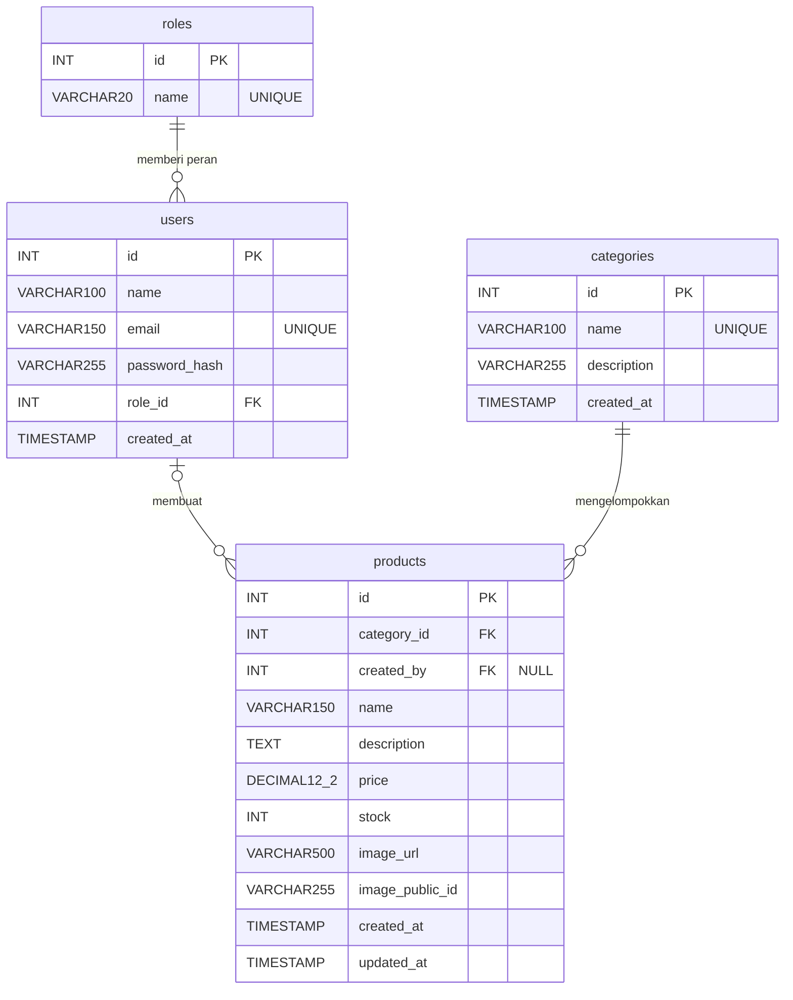

# ERD FashionHub

Diagram ini menggambarkan tabel yang benar-benar ada pada `database/schema.sql`.
Fitur beli saat ini mengurangi `products.stock` dalam transaksi database, tetapi
belum membuat catatan pesanan atau pembayaran.

Relasi:
- Satu `role` dapat dimiliki banyak `users`; setiap user harus memiliki satu role.
- Satu `category` dapat mengelompokkan banyak `products`; setiap produk harus memiliki satu kategori.
- Satu `user` dapat membuat banyak `products`; `created_by` pada produk boleh kosong.

`category_id` menggunakan `ON DELETE RESTRICT`; kategori yang masih dipakai produk
tidak dapat dihapus. `created_by` menggunakan `ON DELETE SET NULL`; produk tetap
ada jika akun pembuatnya dihapus.
