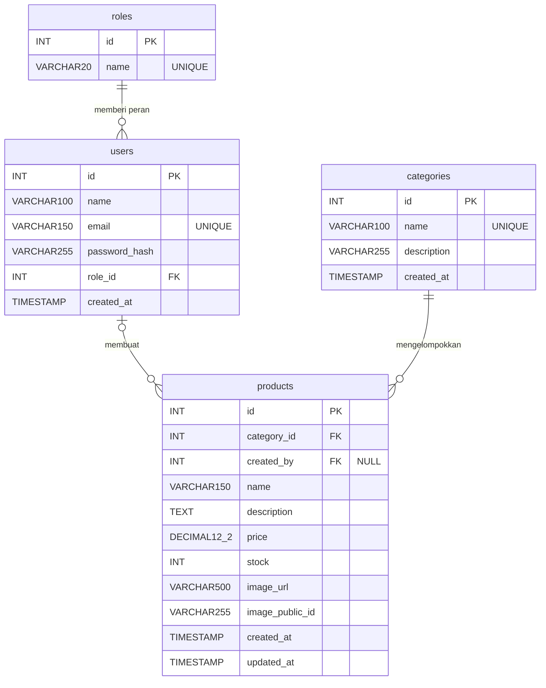

# Software Requirements Specification (SRS)

## FashionHub - Aplikasi Katalog, Stok, dan Pembelian Produk Fashion

| Informasi | Keterangan |
|---|---|
| Versi dokumen | 1.0 |
| Tanggal | 18 November 2026 |
| Sistem | FashionHub |
| Jenis aplikasi | Aplikasi mobile Flutter dan REST API |
| Basis data | MySQL |

## 1. Pendahuluan

### 1.1 Tujuan

Dokumen ini menjelaskan kebutuhan fungsional dan nonfungsional FashionHub sebagai
acuan implementasi, pengujian, dan evaluasi proyek. Sistem menyediakan aplikasi
Flutter untuk pengguna dan admin, REST API berbasis Node.js/Express, serta basis
data MySQL untuk mengelola akun, kategori, produk, dan stok.

### 1.2 Ruang Lingkup

FashionHub adalah aplikasi katalog dan manajemen stok fashion. Admin mengelola
kategori dan produk, termasuk gambar produk. Pengguna dapat melihat katalog,
mencari dan memfilter produk, serta membeli satu unit produk melalui tombol
**Beli Produk**. Pembelian mengurangi stok secara aman.

Pembelian pada versi ini belum merupakan checkout e-commerce penuh: sistem belum
menyimpan pesanan/transaksi, menyediakan keranjang, memproses pembayaran, atau
mengelola pengiriman. Karena itu, riwayat pembelian dan bukti transaksi tidak
tersedia.

### 1.3 Istilah

| Istilah | Arti |
|---|---|
| Admin | Pengguna dengan hak mengelola kategori dan produk |
| User | Pengguna yang dapat melihat katalog dan membeli produk |
| JWT | Token autentikasi yang dikirim sebagai Bearer token |
| Stok menipis | Produk dengan stok 5 unit atau kurang |
| Cloudinary | Layanan penyimpanan dan penyajian gambar produk |

### 1.4 Referensi

- `database/schema.sql` - definisi tabel dan relasi basis data.
- `backend/src/routes/` - endpoint REST API.
- `mobile_fashion/lib/` - aplikasi Flutter.
- [ERD FashionHub](./ERD.md) - diagram entitas dan relasi.

## 2. Gambaran Umum Sistem

### 2.1 Perspektif Produk

FashionHub menggunakan arsitektur client-server:

1. Aplikasi Flutter mengirim permintaan HTTP/JSON ke REST API.
2. REST API memvalidasi permintaan, mengautentikasi pengguna, dan mengakses MySQL.
3. Gambar produk diunggah melalui backend ke Cloudinary; URL gambar disimpan di
   tabel produk.
4. Aplikasi menerima respons JSON dengan struktur umum
   `{ success, message, data }`; respons validasi dapat menyertakan `errors`.

### 2.2 Kelas Pengguna

| Aktor | Hak dan tanggung jawab |
|---|---|
| Pengunjung | Membuat akun atau masuk melalui aplikasi |
| User | Melihat dashboard, kategori, produk dan detail; mencari/filter produk; membeli produk; mengubah profil dan password |
| Admin | Hak user, ditambah mengelola kategori serta menambah, mengubah, dan menghapus produk |

Registrasi hanya menghasilkan role `user`. Akun admin disediakan melalui proses
seed, bukan pilihan pada formulir registrasi.

### 2.3 Lingkungan Operasi

- Aplikasi klien: Flutter/Dart, source berada di `mobile_fashion/`.
- Server: Node.js dan Express.
- Basis data: MySQL 8, tabel menggunakan InnoDB.
- Penyimpanan gambar: Cloudinary.
- Koneksi klien-server: HTTP REST dengan JSON; unggah gambar memakai multipart.
- URL API bawaan klien: emulator Android menggunakan `10.0.2.2:3000`; web dan
  desktop menggunakan `localhost:3000`. Perangkat fisik memerlukan alamat IP
  komputer server yang dapat dijangkau.

### 2.4 Batasan dan Asumsi

- Pengguna harus terhubung ke server untuk login dan menggunakan data.
- Sebagian besar fitur utama di aplikasi Flutter hanya dapat dibuka setelah login.
- Token JWT berlaku satu hari secara default, dan durasinya dapat dikonfigurasi.
- Unggah gambar produk menerima JPG/JPEG, PNG, atau WEBP dengan ukuran maksimum
  2 MB.
- Satu permintaan pembelian hanya mengurangi stok sebanyak satu unit.
- Jumlah stok awal serta pengelolaan produk dilakukan admin.
- Harga ditampilkan dalam format Rupiah.

## 3. Kebutuhan Antarmuka

### 3.1 Antarmuka Pengguna

Aplikasi Flutter menyediakan:

- Splash screen dan pemulihan sesi.
- Layar login dan registrasi.
- Navigasi utama: Beranda, Produk, Kategori, dan Profil.
- Dashboard berisi total produk, total stok, nilai stok, jumlah kategori, jumlah
  produk dengan stok menipis, dan hingga lima produk terbaru.
- Daftar produk dalam grid, pencarian nama, filter kategori, dan detail produk.
- Form admin untuk menambah/mengubah produk dan memilih gambar dari galeri atau
  kamera.
- Pengelolaan kategori oleh admin.
- Profil untuk mengubah nama/password serta keluar dari akun.
- Indikator proses, pesan sukses/kesalahan, keadaan data kosong, dan aksi coba
  kembali pada pemuatan data.

Tombol pengelolaan kategori/produk hanya ditampilkan untuk admin. Tombol beli
ditampilkan untuk user dan dinonaktifkan ketika stok habis.

### 3.2 Antarmuka Perangkat Lunak

| Komponen | Antarmuka |
|---|---|
| Flutter ke backend | HTTP REST, JSON, header `Authorization: Bearer <token>` |
| Unggah gambar | `multipart/form-data`, nama field `image` |
| Backend ke MySQL | Query SQL menggunakan `mysql2/promise` |
| Backend ke Cloudinary | Upload dan penghapusan aset gambar |
| Penyimpanan sesi mobile | Token disimpan secara lokal menggunakan `shared_preferences` |

### 3.3 Endpoint API

| Method dan path | Akses | Tujuan |
|---|---|---|
| `POST /api/auth/register` | Publik | Membuat akun user |
| `POST /api/auth/login` | Publik | Memvalidasi kredensial dan memberikan token |
| `GET /api/auth/me` | User/Admin | Mengambil profil akun aktif |
| `PUT /api/auth/profile` | User/Admin | Mengubah nama profil |
| `PUT /api/auth/password` | User/Admin | Mengubah password dengan verifikasi password lama |
| `GET /api/categories` | User/Admin | Mengambil kategori beserta jumlah produk |
| `POST /api/categories` | Admin | Membuat kategori |
| `PUT /api/categories/:id` | Admin | Mengubah kategori |
| `DELETE /api/categories/:id` | Admin | Menghapus kategori yang tidak sedang dipakai |
| `GET /api/products` | Publik | Mengambil daftar produk, opsional `search` dan `category_id` |
| `GET /api/products/:id` | Publik | Mengambil detail produk |
| `POST /api/products` | Admin | Membuat produk, dapat menyertakan gambar |
| `PUT /api/products/:id` | Admin | Mengubah produk, dapat mengganti gambar |
| `DELETE /api/products/:id` | Admin | Menghapus produk |
| `POST /api/products/:id/purchase` | User | Membeli satu unit dan mengurangi stok |

`GET /api/products` dan `GET /api/products/:id` tidak meminta token di backend.
Endpoint kategori, profil, pembelian, dan operasi admin memerlukan autentikasi
sesuai hak aksesnya.

Respons sukses menggunakan `success: true`; respons gagal menggunakan
`success: false` dan pesan kesalahan. Status yang umum digunakan:

- `200` untuk operasi baca/ubah/hapus berhasil; `201` untuk registrasi atau
  pembuatan data berhasil.
- `400` untuk JSON atau tipe berkas yang tidak valid; `401` untuk autentikasi
  gagal; `403` untuk role yang tidak berhak.
- `404` untuk endpoint atau data yang tidak ditemukan; `409` untuk data duplikat,
  kategori yang masih dipakai, atau stok pembelian habis.
- `413` untuk gambar melebihi 2 MB; `422` untuk validasi input; `502` jika
  layanan Cloudinary gagal.

## 4. Kebutuhan Fungsional

| ID | Kebutuhan |
|---|---|
| FR-01 | Sistem harus menampilkan splash screen dan memeriksa token tersimpan. Jika token masih berlaku, aplikasi membuka halaman utama; jika tidak, aplikasi menampilkan login. |
| FR-02 | Sistem harus memungkinkan pengunjung mendaftar dengan nama 2-100 karakter, email valid, dan password minimal 6 karakter. Akun baru harus diberi role `user`. |
| FR-03 | Sistem harus memvalidasi email dan password saat login, lalu memberikan token autentikasi dan data user. Kredensial salah harus ditolak. |
| FR-04 | Sistem harus menghapus token lokal saat pengguna memilih logout dan mengembalikan aplikasi ke halaman login. |
| FR-05 | Sistem harus memungkinkan user/admin melihat profil, mengubah nama, dan mengganti password setelah password lama diverifikasi. |
| FR-06 | Sistem harus menerapkan otorisasi berbasis role pada operasi yang memerlukan login. Hanya admin yang dapat mengelola kategori dan produk; pembelian hanya dapat dilakukan user. |
| FR-07 | Sistem harus menampilkan daftar kategori dan jumlah produk pada setiap kategori. Admin dapat menambah, mengubah, dan menghapus kategori. Nama kategori harus 2-100 karakter, deskripsi maksimal 255 karakter, nama harus unik, dan kategori yang masih digunakan produk tidak dapat dihapus. |
| FR-08 | Sistem harus menampilkan katalog produk dengan nama, harga, stok, kategori, dan gambar jika tersedia. Katalog dapat dicari berdasarkan nama dan difilter menurut kategori. |
| FR-09 | Sistem harus menampilkan detail produk berupa gambar, nama, kategori, harga, stok, deskripsi, dan nama pembuat bila tersedia. |
| FR-10 | Admin harus dapat membuat, mengubah, dan menghapus produk. Data produk mencakup nama, deskripsi opsional, harga, stok, kategori, dan gambar opsional. |
| FR-11 | Sistem harus memvalidasi data produk: nama 2–150 karakter, deskripsi maksimum 2.000 karakter, harga tidak negatif, stok bilangan bulat tidak negatif, dan kategori wajib valid. |
| FR-12 | Sistem harus menerima gambar JPG/JPEG, PNG, atau WEBP maksimal 2 MB, mengunggahnya ke Cloudinary, serta menghapus gambar lama ketika diganti atau produk dihapus. |
| FR-13 | User harus dapat membeli satu unit produk yang memiliki stok. Pembelian harus mengunci/memeriksa stok dalam transaksi, mengurangi stok tepat satu unit, dan mengembalikan stok terbaru. |
| FR-14 | Sistem harus menolak pembelian jika produk tidak ditemukan atau stok habis. Untuk stok habis, sistem mengembalikan konflik dan tidak boleh membuat stok bernilai negatif. |
| FR-15 | Dashboard harus menampilkan total produk, total unit stok, nilai stok (harga dikali stok), kategori, jumlah produk dengan stok <= 5, dan maksimal lima produk terbaru. |
| FR-16 | Sistem harus menampilkan pesan yang sesuai untuk keberhasilan/kegagalan operasi, kesalahan jaringan, data kosong, dan validasi; operasi data harus menyediakan pemuatan ulang jika diperlukan. |

## 5. Kebutuhan Nonfungsional

| ID | Kebutuhan |
|---|---|
| NFR-01 Keamanan | Password harus disimpan sebagai hash bcrypt, bukan teks biasa. Endpoint terlindungi harus menggunakan JWT dan memeriksa role di backend. |
| NFR-02 Integritas | Relasi basis data harus ditegakkan dengan foreign key. Pengurangan stok saat pembelian harus atomik agar permintaan bersamaan tidak menjual stok melebihi ketersediaan. |
| NFR-03 Validasi | Backend harus memvalidasi input dan mengembalikan status HTTP serta pesan kesalahan yang konsisten. Validasi klien tidak menggantikan validasi backend. |
| NFR-04 Kinerja komunikasi | Permintaan HTTP dari aplikasi memiliki batas waktu 15 detik; aplikasi harus menampilkan pesan bila server tidak dapat dijangkau atau waktu habis. |
| NFR-05 Kemudahan penggunaan | Navigasi utama harus tersedia melalui empat tab, dan tindakan destruktif seperti penghapusan harus meminta konfirmasi. |
| NFR-06 Kompatibilitas | Aplikasi harus dapat diarahkan ke URL backend yang sesuai dengan lingkungan emulator, desktop/web, atau perangkat fisik. |
| NFR-07 Pemeliharaan | Backend dan Flutter harus berkomunikasi menggunakan kontrak JSON yang konsisten; data persisten disimpan di MySQL, sedangkan token sesi disimpan lokal di perangkat. |

## 6. Aturan Bisnis

1. Role yang tersedia adalah `admin` dan `user`.
2. Registrasi publik tidak boleh memberikan role admin.
3. Setiap produk harus terkait dengan satu kategori.
4. Kategori tidak dapat dihapus selama masih memiliki produk.
5. Menghapus akun pembuat produk tidak menghapus produk; nilai `created_by`
   menjadi `NULL`.
6. Pembelian hanya berlaku untuk satu unit per permintaan dan langsung mengurangi
   stok.
7. Versi ini tidak menyimpan siapa yang membeli produk, waktu pembelian, total
   pembayaran, maupun riwayat transaksi.

## 7. Alur Use Case Utama

### UC-01 - Registrasi dan Login

1. Pengunjung membuka aplikasi dan memilih Register.
2. Pengunjung mengisi nama, email, password, dan konfirmasi password.
3. Sistem memvalidasi data dan membuat akun ber-role user.
4. Pengguna kembali ke halaman login, masuk, lalu menerima token.
5. Aplikasi menyimpan token dan membuka dashboard.

### UC-02 - Menelusuri Produk

1. User membuka tab Produk.
2. User mencari nama produk atau memilih filter kategori.
3. Sistem menampilkan daftar yang sesuai.
4. User membuka salah satu produk untuk melihat detail dan stok.

### UC-03 - Membeli Produk

1. User membuka detail produk yang memiliki stok.
2. User memilih **Beli Produk**.
3. Sistem memeriksa stok dalam transaksi database.
4. Jika stok tersedia, sistem mengurangi stok satu unit dan mengirim stok terbaru.
5. Aplikasi memperbarui detail dan menampilkan pesan berhasil. Jika stok habis,
   sistem menampilkan pesan kegagalan dan stok tidak berubah.

### UC-04 - Mengelola Katalog oleh Admin

1. Admin masuk ke aplikasi.
2. Admin menambah/mengubah produk melalui form dan dapat memilih gambar dari
   galeri atau kamera.
3. Sistem memvalidasi data dan menyimpan perubahan ke MySQL.
4. Jika gambar diunggah, backend menyimpannya di Cloudinary.
5. Aplikasi memuat ulang daftar/dashboard agar perubahan tampil.

### UC-05 - Mengelola Kategori oleh Admin

1. Admin membuka tab Kategori dan memilih tambah, edit, atau hapus.
2. Sistem memvalidasi nama/deskripsi dan memastikan nama kategori unik.
3. Sistem menyimpan perubahan; penghapusan ditolak jika kategori masih
   digunakan produk.
4. Aplikasi menampilkan hasil operasi dan memuat ulang data kategori.

### UC-06 - Mengubah Profil

1. User atau admin membuka tab Profil.
2. Pengguna dapat mengubah nama atau mengirim password lama dan password baru.
3. Sistem memvalidasi data; perubahan password hanya dilakukan jika password
   lama cocok dan password baru memenuhi batas minimal.
4. Pengguna dapat logout, yang menghapus token sesi dari perangkat.

## 8. Model Data dan ERD

Basis data terdiri dari empat entitas: `roles`, `users`, `categories`, dan
`products`. Rincian diagram dan relasi tersedia di [ERD FashionHub](./ERD.md).

Tidak ada entitas `orders`, `order_items`, atau `payments` pada skema saat ini.
Endpoint pembelian hanya memperbarui stok produk.

## 9. Kriteria Penerimaan

1. Pengunjung dapat mendaftar dan masuk sebagai user; pendaftaran tidak dapat
   menghasilkan admin.
2. User dapat melihat, mencari, memfilter, dan membuka detail produk.
3. User dapat membeli produk dengan stok lebih dari nol; stok berkurang tepat
   satu. Pembelian saat stok nol ditolak.
4. User tidak dapat mengakses operasi admin; admin dapat mengelola kategori dan
   produk setelah autentikasi.
5. Produk dengan gambar yang tidak didukung atau lebih dari 2 MB ditolak.
6. Dashboard menunjukkan jumlah dan nilai stok yang sesuai dengan data produk.
7. Perubahan nama/password profil mengikuti validasi; password lama yang salah
   tidak mengubah password akun.
8. Kegagalan koneksi atau validasi ditampilkan kepada pengguna tanpa dianggap
   sebagai operasi berhasil.

## 10. Batasan Versi dan Pengembangan Selanjutnya

Fitur berikut tidak termasuk ruang lingkup implementasi yang ada: keranjang
belanja, pembelian beberapa unit dalam satu transaksi, alamat pengiriman,
perhitungan ongkir, gateway pembayaran, status pesanan, invoice, dan riwayat
pembelian. Fitur-fitur tersebut memerlukan model transaksi baru dan perubahan
alur backend maupun Flutter.
